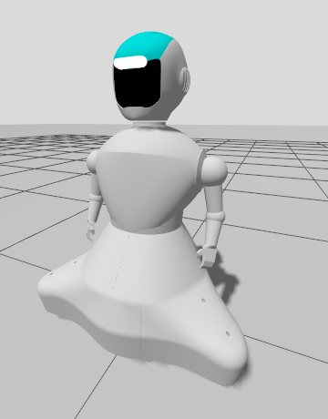
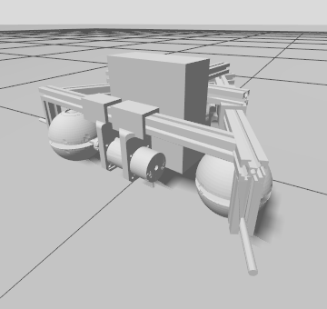

# semubot_description

## **Overview**
Description package for SemuBot. Includes the URDF/xacro model with a RealSense D435i depth camera, omni-ball drive, arms, and Gazebo simulation support.

## **Table of Contents**
- [Installation](#installation)
- [Dependencies](#dependencies)
- [Building the Package](#building-the-package)
- [Launch Files](#launch-files)
- [Gazebo Simulation](#gazebo-simulation)
- [RealSense D435i Camera](#realsense-d435i-camera)
- [License](#license)

---

## **Installation**

### **1. Clone the Repository**
```bash
cd ~/<YOUR_WORKSPACE_NAME_HERE>/src
git clone https://github.com/SemuBot/semubot_description.git
```

## **Dependencies**
### **1. List of dependencies**
1.1. rviz2<br>
1.2. urdf<br>
1.3. xacro<br>
1.4. realsense2_description — only required when using `camera:=true`<br>
1.5. gz-sim (Gazebo Harmonic or newer) — only required for simulation

### **2. Install ROS dependencies**
```bash
cd ~/<YOUR_WORKSPACE_NAME_HERE>
rosdep install --from-paths src --ignore-src -r -y
```

### **3. Install realsense2_description (optional)**
Only needed if using the camera:
```bash
sudo apt install ros-$ROS_DISTRO-realsense2-description
```

## **Building the package**
```bash
cd ~/<YOUR_WORKSPACE_NAME_HERE>
colcon build --packages-select semubot_description
```

## **Launch files**
### **1. Source workspace**
```bash
source ~/<YOUR_WORKSPACE_NAME_HERE>/install/setup.bash
```
### **2. Available launch files**
#### 2.1. Display robot in RViz
Displays the robot model in RViz, starts `joint_state_publisher` and `robot_state_publisher`.
```bash
ros2 launch semubot_description display_robot.launch.py            # V1
ros2 launch semubot_description display_robot.launch.py version:=v2
```

## **Robot versions**
| SemuBot V1 | V1 with camera (`camera:=true`) | SemuBot V2 wheelbase |
|---|---|---|
|  |  |  |

- **V1**: `urdf/semubot.urdf.xacro`, full robot.
- **V2**: `urdf/semubot_v2.urdf.xacro`, wheelbase only for now. Its meshes in `meshes/v2/` are generated from the Onshape URDF export:
  ```bash
  python3 scripts/onshape_v2_meshes.py <export>/urdf/base_frames_vNN.urdf meshes/v2
  ```
  The script also prints the wheel geometry; copy it into the properties at the top of the xacro if it changed.

Both versions use the same joint names (`omni_ball_1..3_joint`: front-left, front-right, rear) and the shared `ros2_control` block in `urdf/ros2_control.xacro`, which is left out when `sim:=true`.

## **Gazebo Simulation**
The URDF supports Gazebo via the `sim:=true` xacro argument, which loads:
- Joint state publisher plugin
- Odometry publisher plugin (publishes on `/odom` and TF)
- Velocity control plugin (subscribes to `/cmd_vel`)
- RGBD camera sensor 

To run SemuBot in Gazebo, use [semubot_gazebo](https://github.com/SemuBot/semubot_gazebo):
```bash
ros2 launch semubot_gazebo gazebo.launch.py              # version:=v1|v2
```

## **RealSense D435i Camera**
The RealSense D435i is optional and disabled by default. Enable it with `camera:=true`. In simulation it is modelled as an RGBD sensor on the `/camera` topic.

## **License**
This project is licensed under the Apache 2.0 license - see the [LICENSE](LICENSE) file for more information.
